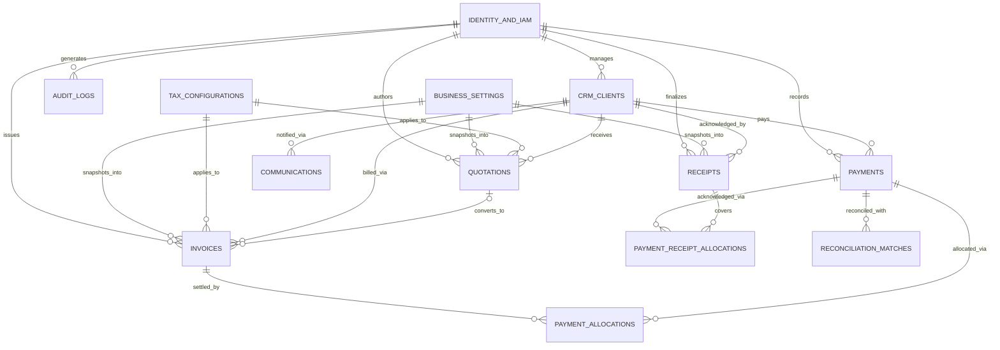
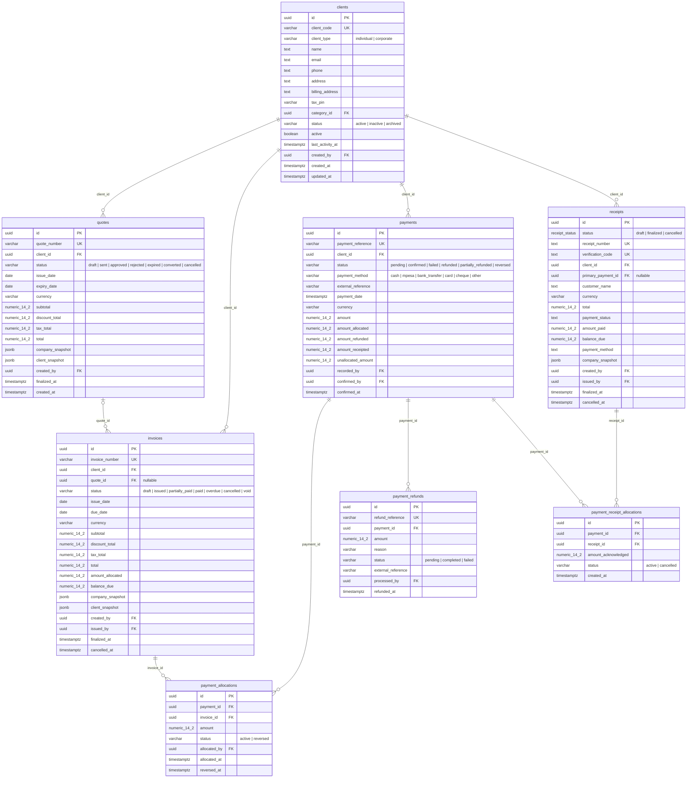
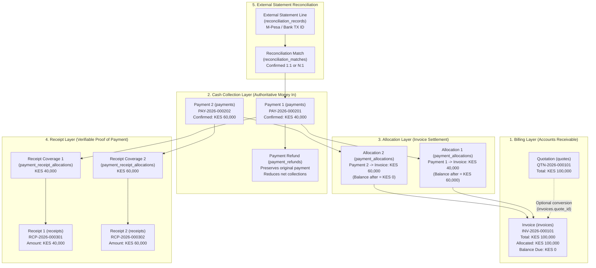
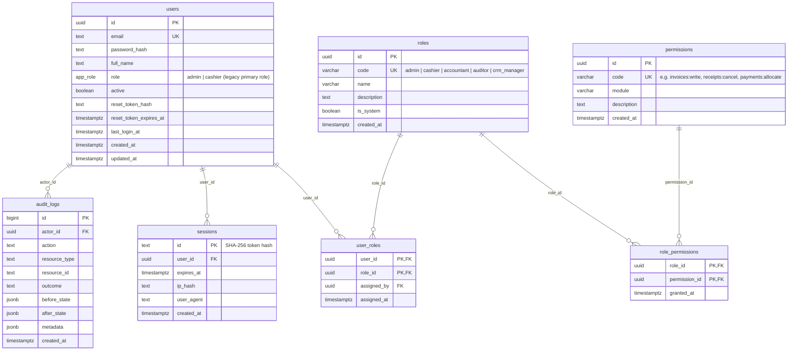

# MP-14 · Deliverable 2: Complete Entity Relationship Diagrams (ERDs)

**Project:** Integrated Business Management System (IBMS)  
**Prompt ID:** MP-14

This document provides all five required Entity Relationship Diagrams in maintainable Mermaid `erDiagram` and `flowchart` syntax:
1. **High-Level Domain ERD**
2. **Complete Logical ERD**
3. **Physical Database ERD (with PostgreSQL Data Types, PKs, FKs, UKs)**
4. **Financial Transaction Relationship Diagram**
5. **User, Role & Permission (RBAC) Relationship Diagram**

---

## 1. High-Level Domain ERD

Shows how the 10 core domain clusters connect across the business lifecycle (`Client → Interaction → Quotation → Invoice → Payment → Receipt → Reconciliation → Audit`).

---

## 2. Complete Logical ERD

Shows every canonical entity, relationship cardinality (`||--o{`, `|o--o{`, `}o--o{`), and junction table across the entire platform.

```mermaid
erDiagram
    users ||--o{ sessions : "has_active"
    users ||--o{ user_roles : "assigned"
    roles ||--o{ user_roles : "granted_to"
    roles ||--o{ role_permissions : "includes"
    permissions ||--o{ role_permissions : "belongs_to"
    users ||--o{ audit_logs : "performs"

    client_categories |o--o{ clients : "categorizes"
    clients ||--o{ client_contacts : "has_contacts"
    clients ||--o{ client_tag_assignments : "tagged_with"
    client_tags ||--o{ client_tag_assignments : "applied_to"
    clients ||--o{ client_interactions : "has_history"
    clients ||--o{ client_documents : "owns_files"
    file_metadata ||--o{ client_documents : "stores_ref"

    clients ||--o{ quotes : "requests"
    quotes ||--|{ quote_items : "contains"
    tax_configurations |o--o{ quote_items : "taxes"

    clients ||--o{ invoices : "owes"
    quotes |o--o{ invoices : "converted_into"
    invoices ||--|{ invoice_items : "contains"
    tax_configurations |o--o{ invoice_items : "taxes"

    clients ||--o{ payments : "remits"
    payments ||--o{ payment_allocations : "allocates"
    invoices ||--o{ payment_allocations : "receives_allocation"
    payments ||--o{ payment_refunds : "refunded_by"

    clients ||--o{ receipts : "issued_to"
    receipts ||--|{ receipt_items : "itemizes"
    payments ||--o{ payment_receipt_allocations : "covered_by"
    receipts ||--o{ payment_receipt_allocations : "acknowledges"
    receipts |o--o{ verify_attempts : "verified_by"

    reconciliation_batches ||--o{ reconciliation_records : "contains_lines"
    reconciliation_records ||--o{ reconciliation_matches : "matched_in"
    payments |o--o{ reconciliation_matches : "matched_to"
    invoices |o--o{ reconciliation_matches : "matched_to_invoice"

    notification_templates |o--o{ email_logs : "renders"
    notification_templates |o--o{ sms_logs : "renders"
    clients |o--o{ email_logs : "receives_email"
    clients |o--o{ sms_logs : "receives_sms"
```

---

## 3. Physical Database ERD (Core Tables, Columns, Keys & Types)

---

## 4. Financial Transaction Relationship Diagram

Illustrates the strict separation between **Billing (`invoices`)**, **Cash Collection (`payments`)**, **Invoice Settlement (`payment_allocations`)**, **Acknowledgment (`receipts` + `payment_receipt_allocations`)**, **Reversals (`payment_refunds`)**, and **Bank/M-Pesa Reconciliation (`reconciliation_matches`)**.

---

## 5. User, Role & Permission (RBAC) Relationship Diagram

